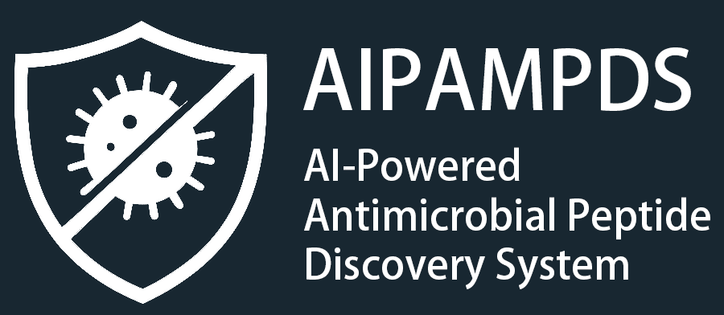

<p align="center">
  
</p>

# AIPAMPDS

This repository includes the official implementation of [AIPAMPDS: an AI platform for antimicrobial peptide design and screening](https://www.biorxiv.org/content/10.1101/2025.03.24.644774v1). We provide pretrained models, local inference code, and runnable examples for antimicrobial peptide (AMP) generation, antimicrobial activity prediction, and hemolytic risk assessment.

The command-line interface (CLI), interactive terminal wizard, and Python API support two workflows:

| Workflow | Start with | Get back |
| --- | --- | --- |
| **Screen** | Your peptide sequences, supplied as FASTA, plain text, or Python inputs | Ranked predictions for AMP identity, activity against *Escherichia coli* and *Staphylococcus aureus*, and non-hemolysis |
| **Generate** | A broad-spectrum or species-specific generation target | New peptide candidates with physicochemical descriptors and ranked screening results |

Both workflows return results sorted by the number of screening criteria passed. See [Results](#results) for score definitions and evaluation thresholds.

[Quick start](#quick-start) · [CLI](#command-line-usage) · [Python API](#python-api) · [Results](#results) · [Models and weights](#models-and-weights) · [GPU setup](#gpu-setup) · [Troubleshooting](#troubleshooting)

## Quick start

### Requirements

- **Platform:** Linux x86-64 is the reference environment.
- **Python:** 3.10 or 3.11. The repository setup uses Python 3.10, which uv can download automatically.
- **Package manager:** [uv](https://docs.astral.sh/uv/getting-started/installation/) 0.13.1 or newer.
- **Resources:** at least 8 GB of available RAM and approximately 2 GB for checkpoints, plus space for the Python environment. Larger screening batches require more memory.

The steps below run inference on CPU. For NVIDIA GPU inference, use the optional [GPU setup](#gpu-setup).

### 1. Install dependencies

Run all repository commands from the repository root:

```bash
uv sync --locked --extra cpu
```

uv creates `.venv` and installs the dependencies recorded in `uv.lock`.

### 2. Download model weights

```bash
uv run aipampds download-weights
```

This downloads and verifies all seven checkpoints. By default, they are stored in the user cache; see [Model weights](#model-weights) to choose another directory.

### 3. Screen the example peptides

```bash
uv run aipampds screen --device cpu --input examples/peptides.fasta --output results/screened.csv
```

The command creates `results/screened.csv`, sorts the results by `Score`, and prints up to ten rows in the terminal. Choose a new output filename for each run; the CLI rejects existing files.

To explore both workflows interactively, run `uv run aipampds interactive`. The examples below use the CPU dependency environment. After installing GPU dependencies, keep `--extra cu128` in subsequent `uv run` commands as described in [GPU setup](#gpu-setup).

## Command-line usage

### Screen existing peptides

Supply a FASTA file, a text file with one sequence per line, or repeated `--sequence` arguments:

```bash
uv run aipampds screen --input examples/peptides.fasta --output results/fasta-screened.csv
uv run aipampds screen --input examples/peptides.txt --output results/text-screened.csv
uv run aipampds screen --sequence GIGKFLHSAKKFGKAFVGEIMNS --sequence KICKRRRSRRRRRRQRRKRCLCRRYQH --output results/direct.csv
```

Input rules apply to both the CLI and Python API:

- Each request accepts 1–10,000 records. Each sequence must contain 5–50 standard amino acids (`ACDEFGHIKLMNPQRSTVWY`).
- Lowercase is converted to uppercase and whitespace is removed. Other characters, including `X`, gaps, digits, and stop symbols, are rejected.
- FASTA records may span multiple lines. Full headers and duplicate records are preserved. Blank lines in plain text are ignored.
- All records are validated before inference. An invalid record produces an error identifying the record and cause; partial predictions are not exported.
- Five-residue peptides receive a warning because the hemolysis model's recommended length starts at six residues.

### Generate new peptides

Choose a generation target, then set the maximum peptide length and number of candidates:

| `--target` | Generation target |
| --- | --- |
| `broad-spectrum` | Broad-spectrum candidates; the default |
| `escherichia-coli` | Candidates targeting *E. coli* |
| `staphylococcus-aureus` | Candidates targeting *S. aureus* |

```bash
uv run aipampds generate \
  --target broad-spectrum \
  --max-length 50 \
  --num-sequences 10 \
  --output results/generated.csv
```

`--max-length` accepts 10–50 and sets an upper bound on sequence length. `--num-sequences` accepts 1–1000. Generation calculates physicochemical descriptors and runs all four screening models for each candidate. The selected target determines which screening criteria contribute to ranking; species-specific results include only the corresponding MIC score column.

Sampling uses the checkpoint-associated start-residue frequencies, batches of eight, temperature 1, and top-k 10. Padding tokens are removed, so sequences may be shorter than `--max-length`. Duplicate peptides are retained. Candidates shorter than five residues are resampled over at most ten sampling rounds; an error is raised if the requested number of valid candidates cannot be produced.

### Shared options and output behavior

`screen`, `generate`, and `interactive` accept the following options:

| Option | Purpose | Default |
| --- | --- | --- |
| `--weights-dir` | Directory containing the model checkpoints | Environment variable or user cache; see [Model weights](#model-weights) |
| `--device` | Device selection for both PyTorch and TensorFlow: `auto`, `cpu`, `cuda`, or `cuda:N` | `auto` |
| `--tensorflow-device` | Independent device selection for the hemolysis model; accepts the same values as `--device` | Inherits `--device` |
| `--batch-size` | Maximum number of sequences per screening batch | `8` |

See [GPU setup](#gpu-setup) for device selection and fallback behavior. Reduce `--batch-size` when memory is limited.

Progress messages go to stderr. The CLI prints a preview and output location to stdout, and saves predictions with full numeric precision to CSV. Output directories are created automatically.

For help, run `uv run aipampds --help`, `uv run aipampds screen --help`, or `uv run python -m aipampds --help`.

Exit codes are `0` for success, `1` for resource or inference failures, `2` for invalid input or arguments, and `130` for interruption.

### Interactive wizard

```bash
uv run aipampds interactive
```

The wizard prompts for a weight directory and device, then offers generation, screening, weight download, or exit. Generation prompts for the target, maximum length, candidate count, and output path. Screening accepts a file or pasted FASTA/plain text; finish pasted input with a blank line.

Press Enter to accept a displayed default. Models remain loaded between operations. Ctrl+C or end-of-input exits the wizard.

## Python API

Create an `AIPAMPDS` pipeline and call `screen` for a sequence or iterable, `screen_file` for a file, or `generate` for new candidates:

```python
from aipampds import AIPAMPDS

pipeline = AIPAMPDS(device="auto", batch_size=8)

single = pipeline.screen("GIGKFLHSAKKFGKAFVGEIMNS")
screened = pipeline.screen([
    "GIGKFLHSAKKFGKAFVGEIMNS",
    "KICKRRRSRRRRRRQRRKRCLCRRYQH",
])
from_file = pipeline.screen_file("examples/peptides.fasta")

generated = pipeline.generate(
    target="broad-spectrum",
    max_length=50,
    num_sequences=10,
)
generated.to_csv("generated.csv", index=False)
```

All three methods return a `pandas.DataFrame` sorted by descending `Score`, preserving input order among ties. `Sequence_ID` identifies records after sorting: sequence inputs use `sequence_1`, `sequence_2`, and so on; generated candidates use `generated_1`, `generated_2`, and so on. File inputs retain FASTA headers, and duplicates are preserved.

The constructor accepts `weights_dir`, `device`, `batch_size`, and `tensorflow_device`, corresponding to the [shared CLI options](#shared-options-and-output-behavior). To run PyTorch models on GPU and the TensorFlow hemolysis model on CPU:

```python
pipeline = AIPAMPDS(device="cuda", tensorflow_device="cpu")
```

Device availability is checked when models load or run. See [Device selection](#device-selection) for automatic fallback and explicit GPU requests. Reuse a pipeline within a process to avoid reloading models; concurrent calls on the same instance are unsupported. Python methods report failures through exceptions.

A runnable example is also provided:

```bash
uv run python examples/python_api.py --device cpu
```

## Results

### Prediction columns

| Column | Meaning |
| --- | --- |
| `Sequence_ID`, `Sequence` | Record identifier and normalized peptide sequence |
| `AMP_Score` | AMP classification score |
| `E.coli_Score` | Activity classification score for *E. coli* |
| `S.aureus_Score` | Activity classification score for *S. aureus* |
| `Hemolytic_Score` | Predicted probability of being **non-hemolytic**; higher is better |
| `Score` | Number of screening criteria passed for the selected target |
| `Evaluate` | Overall category: `Good`, `Mediocre`, or `Bad` |
| `Warning` | Model applicability warning, otherwise empty |

The MIC classifiers return activity scores, **not MIC concentrations**. Despite its name, `Hemolytic_Score` measures the probability of non-hemolysis.

### Ranking and evaluation

Each passed criterion contributes one point to `Score`. Comparisons use full, unrounded predictions:

| Criterion | Pass condition |
| --- | --- |
| AMP | `AMP_Score > 0.998` |
| *E. coli* activity | `E.coli_Score > 0.9980798959732056` |
| *S. aureus* activity | `S.aureus_Score > 0.9989857077598572` |
| Non-hemolysis | `Hemolytic_Score >= 0.5` |

The workflow determines which criteria count and how `Evaluate` is assigned:

| Workflow | Criteria counted | `Good` | `Mediocre` | `Bad` |
| --- | --- | --- | --- | --- |
| Screening or broad-spectrum generation | All four | 4 | 2–3 | 0–1 |
| Species-specific generation | AMP, selected species' activity, and non-hemolysis | 3 | 2 | 0–1 |

### Physicochemical descriptors

Generation also returns the descriptors below, calculated with modlamp. Molecular weight and charge assume C-terminal amidation; charge is evaluated at pH 7.4.

| Column | Definition |
| --- | --- |
| `Length` | Number of amino acids |
| `MW` | Amidated peptide molecular weight, Da |
| `Charge` | Net charge at pH 7.4 with C-terminal amidation |
| `Instability Index` | modlamp instability index |
| `Hydrophobicity` | Global Eisenberg hydrophobicity |
| `Hydrophobic Moment` | Eisenberg hydrophobic moment with modlamp defaults |

## Models and weights

### Model overview

The system uses five model types, distributed as seven checkpoints: three generators and four screening models. Screening applies the four screening models to supplied sequences; generation first creates candidates with the selected generator, then applies the same screening models.

| Model | Role | Output |
| --- | --- | --- |
| **AMP Generation Model** | GPT-based autoregressive generation with broad-spectrum, *E. coli*, and *S. aureus* checkpoints | Candidate amino acid sequences |
| **AMP-Identifier** | ProtBERT-based classification with CNN and LSTM layers | `AMP_Score` |
| **EcoliMIC-Classifier** | Activity classification trained on *E. coli* minimum inhibitory concentration (MIC) labels | `E.coli_Score` |
| **StaphMIC-Classifier** | Activity classification trained on *S. aureus* MIC labels | `S.aureus_Score` |
| **HemoRisk-Estimator** | Attention-based classification of non-hemolytic peptides | `Hemolytic_Score` |

### Model weights

`download-weights` downloads all seven checkpoints from `https://share.pianlab.team/aipampds` and verifies their SHA256 checksums. Valid existing files are reused. Rerun the command after an interrupted download or to replace a corrupted file.

The checkpoint directory is selected in this order:

1. An explicit CLI `--weights-dir` option or Python `weights_dir` argument.
2. The `AIPAMPDS_WEIGHTS_DIR` environment variable.
3. `$XDG_CACHE_HOME/aipampds/weights`, or `~/.cache/aipampds/weights` when `XDG_CACHE_HOME` is unset.

For example, download to a local directory and use it for screening:

```bash
uv run aipampds download-weights --weights-dir ./weights
uv run aipampds screen --weights-dir ./weights --input examples/peptides.fasta --output results/custom-weights.csv
```

Set `AIPAMPDS_WEIGHTS_DIR` to reuse a custom directory across commands. Relative paths resolve when a pipeline is created.

| Checkpoint | Model or generation target |
| --- | --- |
| `finetuning-with-Eco-Sta.pt` | Broad-spectrum generation |
| `finetuning-with-Eco.pt` | *E. coli* generation |
| `finetuning-with-Sta.pt` | *S. aureus* generation |
| `amp_identifier.pt` | AMP-Identifier |
| `ec_model.h5` | EcoliMIC-Classifier |
| `sa_model.h5` | StaphMIC-Classifier |
| `hemolysis.h5` | HemoRisk-Estimator |

Each checkpoint is verified before its first load in a pipeline; files with different checksums are rejected. Models load on first use and are reused by that pipeline. Importing the package, creating a pipeline, and viewing help do not load models or download weights. Inference never downloads missing weights automatically.

The package includes the ProtBERT configuration and tokenizer assets. Once dependencies and checkpoints are installed, inference needs no further downloads or network access.

## GPU setup

### Install GPU dependencies

GPU inference requires an NVIDIA GPU and a driver that supports CUDA 12.8. Confirm that `nvidia-smi` detects the GPU, then install the `cu128` extra:

```bash
uv sync --locked --extra cu128
uv run --locked --extra cu128 aipampds screen --device cuda --input examples/peptides.fasta --output results/screened-gpu.csv
```

The extra installs the CUDA 12.8 build of PyTorch 2.7.0, TensorFlow 2.20.0, and the CUDA/cuDNN runtime dependencies recorded in the lockfile. TensorFlow 2.20.0's official tested build configuration uses **CUDA 12.5 and cuDNN 9.3**; see the [TensorFlow build table](https://www.tensorflow.org/install/source#gpu).

Keep `--extra cu128` in subsequent `uv run` commands to retain the GPU dependency environment. The `cpu` and `cu128` extras are mutually exclusive; do not use `--all-extras`.

### Device selection

`--device` controls both frameworks. PyTorch runs generation, AMP identification, and MIC classification; TensorFlow runs the hemolysis model.

| Value | Behavior |
| --- | --- |
| `cpu` | Load and run all models on CPU |
| `auto` | Each framework independently selects an available GPU, otherwise CPU; this is the default |
| `cuda` | Request visible GPU 0 in both frameworks; raise an error if either required framework cannot use it |
| `cuda:N` | Request visible GPU `N` in both frameworks; raise an error if the requested device is unavailable |

With `auto`, recognized TensorFlow GPU kernel compatibility errors are logged and the hemolysis model is reloaded on CPU. Explicit TensorFlow GPU requests raise an error instead. Out-of-memory errors and other inference failures are propagated.

Use `--tensorflow-device` to choose a separate device for the hemolysis model. For example, run PyTorch on GPU and TensorFlow on CPU:

```bash
uv run --locked --extra cu128 aipampds screen --device cuda --tensorflow-device cpu --input examples/peptides.fasta --output results/screened-mixed.csv
```

Alternatively, use `--device cuda --tensorflow-device auto` to let TensorFlow select its device and fall back on recognized kernel compatibility errors.

Logs show the actual device selected by each framework. `CUDA_VISIBLE_DEVICES` affects device visibility and numbering. TensorFlow enables GPU memory growth before GPU initialization to help share memory with PyTorch. If the caller has already initialized TensorFlow, the existing configuration is retained and a message is logged.

The hemolysis model uses `tf-keras==2.20.1` to load its original HDF5 weights and custom attention layer. See [Keras 2 compatibility](https://keras.io/getting_started/#tensorflow--keras-2-backwards-compatibility) for background and the [TensorFlow installation guide](https://www.tensorflow.org/install/pip) for GPU requirements.

### Verify GPU execution

Run the following test to check that both frameworks execute GPU operations in the same process. Model weights are not required:

```bash
AIPAMPDS_TEST_DEVICE=cuda uv run --locked --extra cu128 pytest tests/test_gpu.py -v
```

The test checks calculation results and tensor placement for matrix multiplication, elementwise operations, and nonlinear operations. It fails if the requested GPU is unavailable or its kernels are incompatible. For model inference and CPU/GPU comparisons, see [GPU and mixed-device tests](#gpu-and-mixed-device-tests).

## Use from another uv project

The consuming project must use Python 3.10 or 3.11. uv dependency overrides and package indexes are root-project settings, so add the following to that project's `pyproject.toml`, merging any existing sections:

```toml
[tool.uv]
override-dependencies = ["mysql-connector-python==9.4.0"]

[tool.uv.sources]
torch = { index = "pytorch-cpu" }

[[tool.uv.index]]
name = "pytorch-cpu"
url = "https://download.pytorch.org/whl/cpu"
explicit = true
```

Then install the package:

```bash
uv add /absolute/path/to/aipampds-release
uv run python -c 'from aipampds import AIPAMPDS; print(AIPAMPDS())'
```

The connector override is also required when installing a built wheel because overrides are not encoded in wheel metadata. `modlamp` pins an older connector whose protobuf requirement conflicts with TensorFlow 2.20; the override selects a compatible connector.

For GPU support, change the PyTorch index URL to `https://download.pytorch.org/whl/cu128`, keeping the index name consistent with the `torch` source reference. Install the GPU extra to include TensorFlow's CUDA dependencies:

```bash
uv add '/absolute/path/to/aipampds-release[cu128]'
```

## Troubleshooting

| Issue | Action |
| --- | --- |
| Missing or corrupted checkpoint | Rerun `download-weights` with the same weight directory. Inference does not download weights automatically. |
| CUDA unavailable | Install the `cu128` extra and check `nvidia-smi`. Selecting `--device cuda` does not install GPU dependencies. Logs identify the affected framework. Use `--device auto` for automatic selection or `--device cpu` for CPU inference. |
| PyTorch detects a GPU but TensorFlow does not | Check that the `cu128` extra installed TensorFlow's CUDA dependencies. Follow the [TensorFlow troubleshooting instructions](https://www.tensorflow.org/install/pip#step-by-step_instructions) to check library paths and system CUDA conflicts, then run the [GPU execution test](#verify-gpu-execution). |
| TensorFlow reports `INVALID_PTX` or `INVALID_HANDLE` | Check GPU compatibility with the TensorFlow build described in [GPU setup](#gpu-setup). Use `--device auto`, or keep PyTorch on GPU with `--device cuda --tensorflow-device cpu`. |
| Memory exhaustion | Lower `--batch-size` to `1`. The AMP identifier contains a large ProtBERT model. |
| Dependency resolution failure | Use the supplied lockfile and Python 3.10; check access to PyPI and PyTorch. Retain the connector override when installing from another project. |
| Output file already exists | Choose a new output filename. |
| Invalid sequence | Correct the record identified in the error. All records must pass validation before inference. |

## Development and verification

### Standard checks

```bash
uv sync --locked --extra cpu
uv run pytest
uv run ruff check .
uv run ruff format --check .
uv build
```

Unit tests require no weights or network. Real-model and GPU tests are optional and are enabled with the environment variables below.

### Real-model integration tests

Supply a checkpoint directory to test single and batched screening, duplicate handling, all three generation targets, model device placement, and descriptor output:

```bash
AIPAMPDS_TEST_WEIGHTS=/absolute/path/to/weights uv run pytest -m integration
```

Real-model tests use CPU by default and are skipped when `AIPAMPDS_TEST_WEIGHTS` is unset.

### GPU and mixed-device tests

For GPU verification, run both the framework execution test and the real-model tests:

```bash
AIPAMPDS_TEST_WEIGHTS=/absolute/path/to/weights AIPAMPDS_TEST_DEVICE=cuda uv run --locked --extra cu128 pytest -m 'integration or gpu' -v
```

Use `cuda:N` to test a specific GPU. The tests check device placement, all generation targets, and CPU/GPU agreement for all four screening scores. Comparisons align records by `Sequence_ID`, use `rtol=1e-4` and `atol=1e-5` for raw scores, and check that the example peptides receive the same `Score` and `Evaluate` values. GPU tests are skipped unless a CUDA test device is requested.

To test the full workflow with PyTorch on GPU and TensorFlow on CPU, set `AIPAMPDS_TEST_TF_DEVICE`, which corresponds to the Python `tensorflow_device` argument:

```bash
AIPAMPDS_TEST_WEIGHTS=/absolute/path/to/weights AIPAMPDS_TEST_DEVICE=cuda AIPAMPDS_TEST_TF_DEVICE=cpu uv run --locked --extra cu128 pytest tests/test_integration.py -v
```

Set `AIPAMPDS_TEST_TF_DEVICE=auto` to exercise CPU fallback when an incompatible TensorFlow GPU kernel is encountered. In mixed-device comparisons, PyTorch scores come from GPU inference and TensorFlow scores may come from CPU inference; these results do not establish TensorFlow GPU model compatibility.

### Reference implementation comparison

If a reference source tree is available separately, compare its results with this package:

```bash
TF_USE_LEGACY_KERAS=1 AIPAMPDS_TEST_WEIGHTS=/absolute/path/to/weights AIPAMPDS_REFERENCE_ROOT=/absolute/path/to/aipampds uv run pytest -m integration
```

The reference source uses `tensorflow.keras`, so `TF_USE_LEGACY_KERAS=1` enables Keras 2 for that code. This package imports `tf_keras` directly.

### Repository layout

```text
src/aipampds/   API, workflows, models, CLI, and tokenizer assets
examples/      Sample inputs and a runnable Python example
tests/         Unit and optional real-model tests
docs/assets/   README images
pyproject.toml Dependencies, build metadata, and CLI registration
uv.lock        Locked CPU/GPU dependencies
```

## Citation

If you use these models in your research, please cite the AIPAMPDS paper:

Li, Y. et al. (2025). **AIPAMPDS: an AI platform for antimicrobial peptide design and screening.** *bioRxiv*. [Read the paper](https://www.biorxiv.org/content/10.1101/2025.03.24.644774v1). DOI: [10.1101/2025.03.24.644774](https://doi.org/10.1101/2025.03.24.644774).
